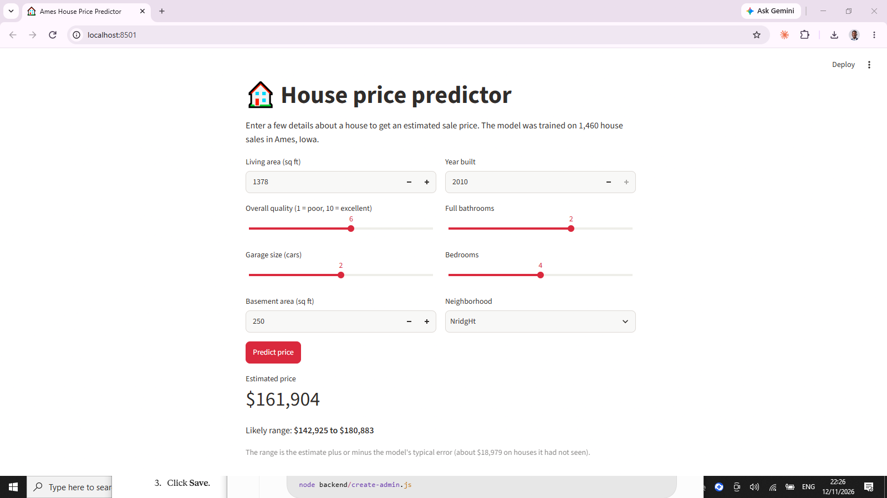
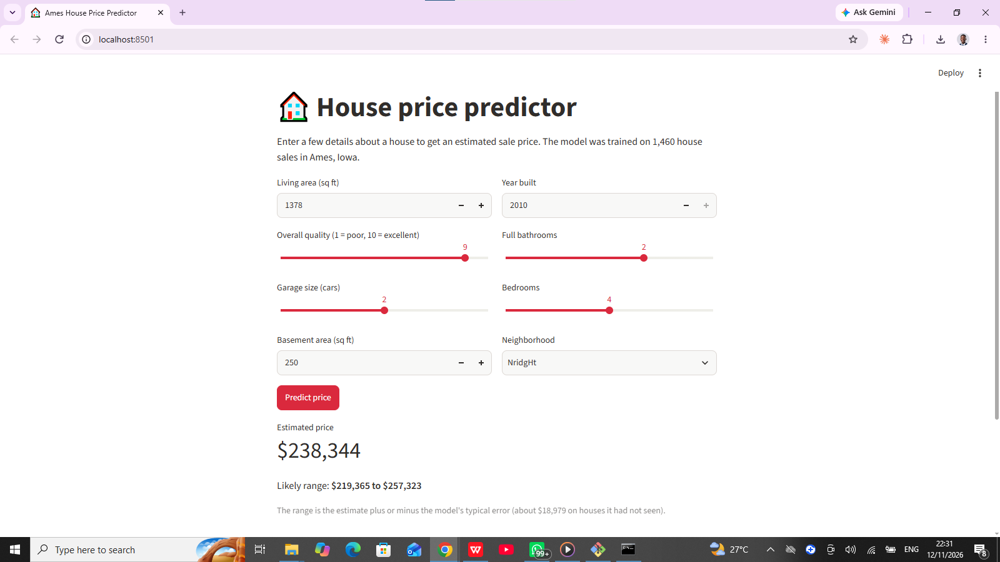

# House Price Prediction

A machine learning project that predicts house sale prices in Ames, Iowa, from a few details a person can type into a form. I built it in my first month of learning data science, from first Python lines to a working app.

## Results at a glance
- Guessing the average price for every house is off by about 62,600.
- My best model, gradient boosting, is off by about 16,600 on a held-out test set (R2 0.90), about 73% lower.
- The app uses 8 inputs instead of about 300 columns and has a typical error of about 19,000 (5-fold cross-validation), because the form has to be usable.
- Overall quality is the most important input (about half of the model's importance), followed by living area.
- The model is weakest on expensive houses and on unfinished new construction (Partial sales).

## Data
From the Kaggle competition "House Prices: Advanced Regression Techniques":
https://www.kaggle.com/c/house-prices-advanced-regression-techniques

Download train.csv and put it in a folder called data. Data files are not stored in this repository.

## The app
A Streamlit app takes 8 inputs (living area, quality, garage, basement, year built, bathrooms, bedrooms, neighborhood) and shows an estimated price with a likely range. The model is trained on one Iowa town, so it should not be used for other markets.

To run it:
1. Put train.csv in the data folder.
2. python -m venv .venv, then activate it
3. pip install -r requirements.txt
4. python train_model.py
5. streamlit run app/app.py

## Projects
1. **Housing data first look** (notebooks 05 and 06): cleaning, neighborhood comparison, and charts.
2. **SQL analysis** (notebook 12): five business questions answered with SQL.
3. **House price model** (notebook 19): seven models compared on one 80/20 split, with error analysis.
4. **Live price predictor app** (the app folder).

## Notebooks
Listed in the order I built them.
- 01_first_look.ipynb: load the data, check its shape and missing values
- 02_python_basics.ipynb: Python practice with variables, lists, dictionaries, and loops
- 03_functions_and_data.ipynb: functions and the first pandas load
- 04_select_filter_sort.ipynb: selecting, filtering, and sorting the houses
- 05_clean_and_group.ipynb: filling missing values and comparing neighborhoods
- 06_charts.ipynb: charts, plus the comparison of quality, location, and size
- 07_sql_setup.ipynb: load the data into a SQLite database and run first SQL queries
- 08_statistics_basics.ipynb: mean, median, standard deviation, and the shape of the price distribution
- 09_sql_queries.ipynb: SQL queries using WHERE, ORDER BY, IN, LIKE, and DISTINCT
- 10_sql_groupby.ipynb: GROUP BY, HAVING, and JOIN, plus a cap rate example
- 11_sql_vs_pandas.ipynb: checks that SQL and pandas agree, plus five practice problems
- 12_project2_sql_analysis.ipynb: Project 2, five business questions answered with SQL
- 13_train_test_split.ipynb: splitting the data into training and test sets
- 14_first_model.ipynb: first linear regression models, from one feature to five
- 15_feature_prep.ipynb: filling gaps, one-hot encoding, and fixing a model that predicted a negative price
- 16_comps.ipynb: valuing houses by comparable sales, and blending that with the linear model
- 17_tree_models.ipynb: random forest and gradient boosting compared with the linear model
- 18_error_analysis.ipynb: where the best model fails, by price range, by house, and by sale type
- 19_project3_house_price_model.ipynb: Project 3, seven models compared, with error analysis and limits
- 20_save_model.ipynb: a compact 8-input model for the app
- 21_overfitting_and_cv.ipynb: overfitting in decision trees, and 5-fold cross-validation
- 22_property_analysis.ipynb: investor analysis of one real listing, and why the Ames model cannot price it

## What I found
- **Missing values:** most empty cells mean the house has no such feature (no pool, alley, fence, or garage), not lost data.
- **Price depends on quality, location, and size together.** Correlations with price: quality 0.79, location 0.74, size 0.71. The location figure is slightly generous because each house is part of its neighborhood's average.
- **Location:** NoRidge has the highest average price (about 335,000) and MeadowV the lowest (about 99,000). StoneBr and NridgHt charge the most per square foot (about 165).
- **Size alone does not set the price:** the two largest houses, both in Edwards, sold for only 160,000 and 184,750.
- **SQL:** average price rises at every step of overall quality (about 50,000 at quality 1 to 438,588 at quality 10). 636 of 1,460 houses sold above their own neighborhood's average.
- **Models:** adding quality gave the biggest improvement, more than switching algorithms. A linear model with all columns predicted a negative price for one house because only 6 houses have pools, so I dropped the pool columns. Tree models handled them better.
- **Where the model fails:** the worst 10 of 292 test houses cause 57% of the squared error. All seven test houses over 400,000 were underpredicted. Partial sales (unfinished new construction) have an average miss of about 42,400, against about 13,400 for Normal sales.
- **Overfitting:** a decision tree with no depth limit is off by about 113 on the houses it trained on and about 25,100 on new ones. Cross-validation shows single-split scores are slightly optimistic.
- **Property analysis:** a 590,000 pound new-build 4-bed in Didcot, UK, at an estimated rent of 2,500 pounds a month, has a gross yield of about 5.1% but a cap rate of about 3.2% after costs (before mortgage, stamp duty, and tax).

## Limits
All model scores come from one town and mostly one train/test split. The model is a learning project, not valuation advice.

## Progress
- [x] First look at the data
- [x] Cleaning and charts
- [x] SQL analysis
- [x] Models
- [ ] Live app (deploying on Streamlit Community Cloud)